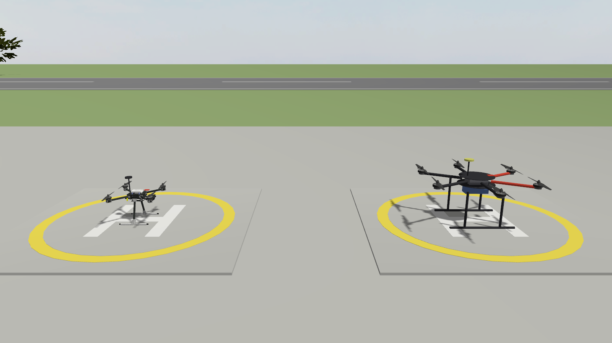
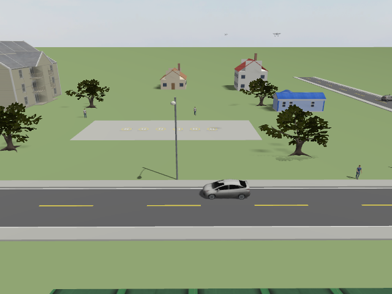
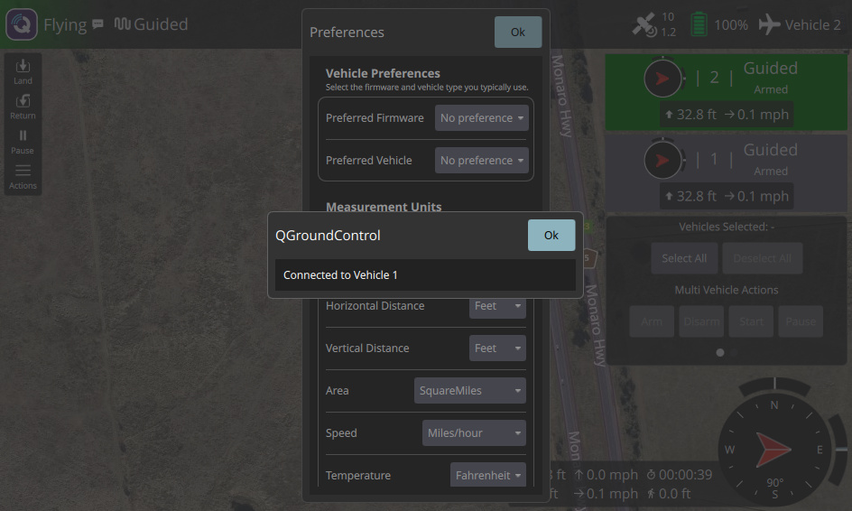
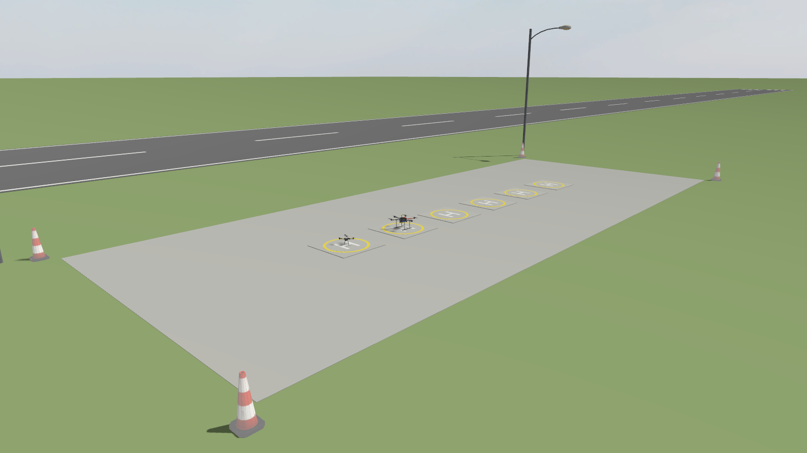
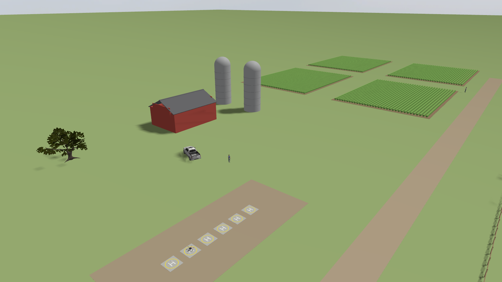
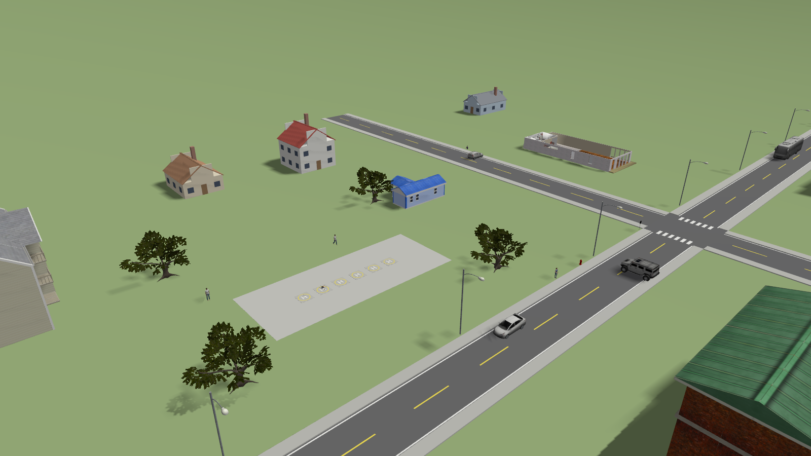
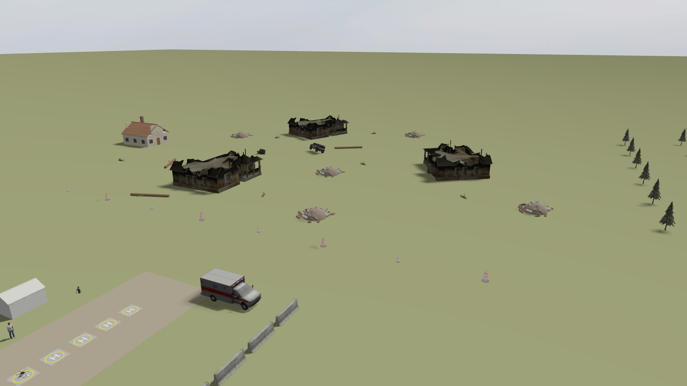

# ROS2_ardupilot — Enxame de drones ArduPilot com ROS 2 Jazzy, Gazebo Harmonic e Zenoh

Ambiente para **desenvolver e testar em simulação** os sistemas ROS 2 de drones que voam com **ArduPilot**, antes de levá-los aos drones reais. A divisão de responsabilidades é a mesma do drone real:

| Camada | Quem faz | O quê |
|---|---|---|
| Controle de voo | **ArduPilot** (o mesmo firmware, compilado como SITL) | malhas de atitude / velocidade / posição, EKF3, modos de voo, failsafes, decolagem, pouso, RTL |
| Alto nível | **ROS 2** | decisão, visão computacional, IA, algoritmos de enxame. Envia **velocidades** ou **posições de destino** (local ou GPS) ao ArduPilot no modo GUIDED |
| Ligação ROS ↔ FC | **MAVROS** + `drone_commander` | a mesma nos dois mundos: em simulação fala com o SITL por TCP, no drone real pela serial |
| Comunicação entre drones | **Zenoh** (`zenoh-bridge-ros2dds`) | cada drone tem o seu próprio domínio DDS (como computadores separados) e a ponte Zenoh faz o papel do rádio |
| Estação de solo | **QGroundControl** + RViz | todos os drones aparecem no QGC (modos de voo, parâmetros, missões) |

Principais características:

- **Dois airframes**: Holybro **X500 V2** (quad X, 2,0 kg, hélices de 10") e um **hexacóptero grande** (classe Tarot 960, 6,0 kg, hélices de 15"), com física de rotor baseada no modelo oficial do ArduPilot para Gazebo e parâmetros ArduPilot próprios.
- **Quatro mundos externos**: aeródromo (`runway`), fazenda (`farm`), vila / pequena cidade (`village`) e área de desastre para busca e salvamento (`disaster`).
- **Vários drones, um por terminal**: `ros2 launch drone_bringup drone.launch.py id:=N` sobe tudo de um drone (modelo, SITL, MAVROS, ponte Gazebo, comandante, ponte Zenoh). Ou tudo de uma vez com `swarm.launch.py`.
- **API de alto nível única** (`drone_commander`): `cmd/velocity`, `cmd/position`, `cmd/global`, serviços `takeoff`, `land`, `rtl`, `hold`, `arm`, `set_mode` e o estado `state`. O mesmo nó roda no drone real.
- **Simulação realista**: SITL em *lock-step* com o Gazebo a 1 kHz, EKF3 real, perfil de sensores `realistic` (ruído de IMU / baro / bússola / GPS, latência), **vento com rajadas** e arrasto aerodinâmico calibrado, colisões físicas, ground truth para avaliação.
- **QGroundControl 5.1.5** dentro do container (todos os drones visíveis) e **MAVProxy**.



---

## Sumário

1. [Arquitetura](#1-arquitetura)
2. [Estrutura do repositório](#2-estrutura-do-repositório)
3. [Versões](#3-versões)
4. [Instalação (Docker)](#4-instalação-docker)
5. [Início rápido](#5-início-rápido)
6. [Launch files em detalhe](#6-launch-files-em-detalhe)
7. [Comandando os drones: API do `drone_commander`](#7-comandando-os-drones-api-do-drone_commander)
8. [Enxame e Zenoh](#8-enxame-e-zenoh)
9. [QGroundControl e MAVProxy](#9-qgroundcontrol-e-mavproxy)
10. [Modelos dos drones](#10-modelos-dos-drones)
11. [Mundos](#11-mundos)
12. [Simulação realista](#12-simulação-realista)
13. [Do simulador para o drone real](#13-do-simulador-para-o-drone-real)
14. [Referência: portas, tópicos, serviços e frames](#14-referência-portas-tópicos-serviços-e-frames)
15. [Validação](#15-validação)
16. [Decisões, limitações e detalhes técnicos](#16-decisões-limitações-e-detalhes-técnicos)
17. [Problemas comuns](#17-problemas-comuns)

---

## 1. Arquitetura

### 1.1 Um drone

Cada drone simulado reproduz a cadeia do drone real. As setas mostram o caminho dos dados:

```
                    ┌──────────────────────────── Gazebo Sim (Harmonic) — um processo para todos os drones ───┐
                    │  modelo droneN: corpo + 4/6 rotores (LiftDrag) + IMU + câmera + ArduPilotPlugin          │
                    └───────────────┬──────────────────────────────────────────┬─────────────────────────────┘
                 JSON / UDP 9002+10i │ lock-step 1 kHz                          │ gz-transport (câmera, ground truth, clock)
                (PWM dos motores ↔   │                                          │
                 IMU, pose, vel.)    │                                          ▼
                    ┌────────────────▼───────────────┐              ┌──────────────────────────┐
                    │ ArduPilot SITL (arducopter)    │              │ ros_gz_bridge + clock_relay│──► /droneN/camera/image_raw
                    │ = firmware do controlador de   │              └──────────────────────────┘    /droneN/ground_truth/odometry
                    │ voo: EKF3, controle, modos,    │                                               /clock (100 Hz)
                    │ failsafes                      │
                    └──┬─────────────┬───────────┬───┘
       SERIAL1 UDP     │   SERIAL0   │ TCP       │ SERIAL2 TCP 5762+10i
       → :14550        │   5760+10i  │           └──────────► MAVProxy / Mission Planner / scripts
          ▼            │             ▼
   QGroundControl      │    ┌──────────────────┐    ┌─────────────────────────────────────────────┐
   (todos os drones)   │    │ MAVROS            │◄──►│ drone_commander  (/droneN/...)              │
                       │    │ /droneN/mavros/*  │    │  cmd/velocity  cmd/position  cmd/global      │◄── seus nós:
                       │    └──────────────────┘    │  takeoff land rtl hold arm set_mode          │    visão, IA,
                       │                            │  state  pose  TF map→droneN/odom→base_link   │    enxame
                       │                            └─────────────────────────────────────────────┘
                       │                                    ROS_DOMAIN_ID = N  ("computador de bordo")
                       │                                              │
                       │                                   zenoh-bridge-ros2dds (peer)  ◄── "rádio" do drone
```

### 1.2 O enxame

Cada drone vive no seu **domínio ROS** (`ROS_DOMAIN_ID = id`): na simulação, todos os processos estão na mesma máquina, mas um drone **não enxerga** o DDS do outro — como no mundo real, em que cada drone tem o seu computador de bordo. A troca de dados entre drones e com a estação de solo passa **somente** pelas pontes Zenoh, e somente as interfaces permitidas (estado, pose, comandos e serviços de alto nível):

```
   domínio 0 (GCS)                       domínio 1 (drone1)          domínio 2 (drone2)         domínio 3 (drone3)
 ┌──────────────────────┐               ┌──────────────────┐        ┌──────────────────┐       ┌──────────────────┐
 │ swarm_monitor, RViz  │               │ MAVROS, commander│        │ MAVROS, commander│       │ MAVROS, commander│
 │ swarm_cli, seus nós  │               │ câmera, seus nós │        │ câmera, seus nós │       │ câmera, seus nós │
 └─────────┬────────────┘               └────────┬─────────┘        └────────┬─────────┘       └────────┬─────────┘
   zenoh-bridge (router)                 zenoh-bridge (peer)         zenoh-bridge (peer)        zenoh-bridge (peer)
   tcp/0.0.0.0:7447  ◄──────────────────  tcp :7448  ◄────────────►  tcp :7449  ◄────────────►  tcp :7450
                         (os peers também se conectam diretamente entre si: malha, como numa rede Wi-Fi)
```

`/drone1/state` tem o mesmo nome em todos os domínios: os nós já vivem no namespace do drone, então a ponte não precisa renomear nada. Um algoritmo de enxame rodando no drone2 assina `/drone1/state` e recebe os dados do drone1 que atravessaram o "rádio".

### 1.3 Simulação × drone real

| Simulação | Drone real |
|---|---|
| Gazebo + `ArduPilotPlugin` | o mundo físico |
| ArduPilot SITL (`arducopter`, mesma versão do firmware) | controlador de voo (Pixhawk / Cube / etc.) |
| MAVROS `fcu_url:=tcp://127.0.0.1:5760+10i` | MAVROS `fcu_url:=/dev/ttyACM0:921600` (ou a TELEM do FC) |
| `drone_commander`, seus nós, ponte Zenoh — **idênticos** | `drone_commander`, seus nós, ponte Zenoh — **idênticos** |
| UDP 14550 → QGroundControl | rádio de telemetria → QGroundControl |
| `ROS_DOMAIN_ID = id` (isolamento na mesma máquina) | um computador de bordo por drone (+ `ROS_DOMAIN_ID = id`) |
| `drone.launch.py` | `real_drone.launch.py` |

---

## 2. Estrutura do repositório

```
ROS2_ardupilot/
├── dockerfile_nvidia_ardupilot_jazzy   # imagem: CUDA + ROS 2 Jazzy + Gazebo Harmonic + ArduPilot SITL + ardupilot_gazebo
│                                       #          + MAVROS + Zenoh bridge + QGroundControl + MAVProxy + modelos
├── docker-compose.yml                  # container (GPU NVIDIA, X11, rede do host)
├── README.md
├── docs/                               # imagens do README
├── scripts/drone_env.bash              # funções do terminal: drone_domain, gcs_domain, qgc, mavlink_console
│
├── robot_description/                  # MODELOS DOS DRONES (SDF gerado por xacro)
│   ├── sdf/
│   │   ├── drone.sdf.xacro             # arquivo principal (args: frame, name, instance, camera, camera_pitch)
│   │   ├── frame_x500v2.xacro          # X500 V2: massas, inércias, geometria, rotores, ordem dos motores
│   │   ├── frame_hexa.xacro            # hexa X grande
│   │   ├── rotor.xacro                 # hélice + junta + 2 pás LiftDrag (empuxo / torque)
│   │   ├── ardupilot_plugin.xacro      # ArduPilotPlugin: porta JSON, lock-step, canais dos motores
│   │   ├── IMU.xacro                   # IMU lida pelo ArduPilotPlugin
│   │   ├── camera.xacro                # câmera RGB (visão / IA)
│   │   ├── gazebo_essentials.xacro     # ground truth (odometria verdadeira)
│   │   ├── inertial_macros.xacro, materials.xacro
│   └── config/frames.yaml              # altura de spawn e montagem da câmera de cada frame
│
├── robot_gazebo/                       # SIMULAÇÃO
│   ├── worlds/  runway.sdf  farm.sdf  village.sdf  disaster.sdf
│   ├── models/                         # modelos próprios (plataformas, pista, celeiro, silos, casas, ruas, tendas, escombros...)
│   ├── launch/
│   │   ├── world.launch.py             # Gazebo + mundo (+ vento inicial)
│   │   ├── spawn_drone.launch.py       # gera o SDF de um drone e o insere no mundo
│   │   └── drone_bridge.launch.py      # ponte ROS ↔ Gazebo de um drone (câmera, ground truth, clock)
│   ├── src/clock_relay.cpp             # /clock do Gazebo (1 kHz) → ROS a 100 Hz
│   ├── scripts/set_wind                # muda o vento durante a simulação
│   └── robot_gazebo/world_info.py      # lê a origem GPS do mundo (usada pelos launches)
│
├── flight_controller/                  # LADO ARDUPILOT
│   ├── config/ardupilot/
│   │   ├── sitl_common.parm            # parâmetros comuns a todos os drones simulados
│   │   ├── x500v2.parm  hexa.parm      # parâmetros de cada airframe (frame, hover, ganhos)
│   │   └── profile_ideal.parm  profile_realistic.parm   # perfis de sensores
│   ├── config/mavros/apm_pluginlists.yaml   # plugins MAVROS carregados (lista de permissão)
│   └── launch/
│       ├── sitl.launch.py              # uma instância do ArduPilot SITL
│       └── mavros.launch.py            # MAVROS de um drone (simulação e real)
│
├── drone_interfaces/                   # mensagens e serviços da API: DroneState, GlobalTarget, Takeoff, SetMode
├── drone_control/                      # ALTO NÍVEL DE UM DRONE (Python)
│   ├── drone_control/
│   │   ├── drone_commander.py          # API ROS 2 → ArduPilot (GUIDED): velocidade / posição / GPS, serviços, estado, TF
│   │   ├── drone_cli.py                # linha de comando de um drone
│   │   ├── teleop_keyboard.py          # teleoperação pelo teclado
│   │   └── geo.py                      # conversões lat/lon ↔ frame do enxame (modelo do ArduPilot e WGS84)
│   └── config/drone_commander.yaml
├── swarm_control/                      # ENXAME (Python)
│   ├── swarm_control/
│   │   ├── swarm_cli.py                # linha de comando do enxame: decolar, formações, pousar...
│   │   ├── formation_follower.py       # exemplo de algoritmo descentralizado (seguir o líder via Zenoh)
│   │   ├── swarm_monitor.py            # estação de solo: marcadores RViz + tabela de estado
│   │   └── formations.py               # geometria das formações (linha, coluna, círculo, grade, V)
│   └── launch/formation_follower.launch.py
└── drone_bringup/                      # ORQUESTRAÇÃO
    ├── launch/
    │   ├── drone.launch.py             # UM drone simulado completo (um por terminal)
    │   ├── swarm.launch.py             # mundo + GCS + vários drones a partir de um YAML
    │   ├── gcs.launch.py               # estação de solo: roteador Zenoh, monitor, RViz, QGC
    │   └── real_drone.launch.py        # drone REAL (computador de bordo)
    ├── config/swarm.yaml               # exemplo de enxame
    ├── config/zenoh/swarm.json5        # configuração da ponte Zenoh (o que atravessa o "rádio")
    └── rviz/swarm.rviz
```

Mesma organização dos outros projetos do repositório: `robot_description` (modelo), `robot_gazebo` (simulação), pacotes de controle e um pacote que junta tudo. Os modelos dos drones são **SDF escritos em xacro** (e não URDF), porque usam recursos do Gazebo que a conversão URDF→SDF não preserva bem (plugins por pá de hélice, juntas fixas sem fusão de links, sensores referenciados pelo plugin do ArduPilot).

---

## 3. Versões

| Componente | Versão | Onde |
|---|---|---|
| Ubuntu (container) | 24.04 (o host pode ser 22.04) | `nvidia/cuda:12.8.1-base-ubuntu24.04` |
| ROS 2 | Jazzy | apt |
| Gazebo | Harmonic (gz-sim 8.15) | apt (OSRF) + vendors do ROS |
| ArduPilot (SITL) | **Copter-4.7.2** (configurável) | `/opt/ardupilot` |
| ardupilot_gazebo (ArduPilotPlugin) | commit `f116b03` | `/opt/ardupilot_gazebo` |
| MAVROS | 2.16 | apt |
| zenoh-bridge-ros2dds | 1.10.2 | `/opt/zenoh` |
| QGroundControl | 5.1.5 | `/opt/qgroundcontrol` |
| MAVProxy | última (venv isolado) | `/opt/mavproxy_venv` |
| Malhas do X500 | PX4-gazebo-models `e5997f4` (BSD-3) | `/opt/px4_gazebo_models` |
| Modelos do Gazebo Fuel | baixados no build | `~/.gz/fuel`, `/opt/fuel_models` |

---

## 4. Instalação (Docker)

Mesmo fluxo dos outros projetos: a imagem instala e compila tudo; o `docker-compose` monta esta pasta em `/ROS2_ardupilot/src`, então o que você edita no host aparece dentro do container.

### 4.1 Pré-requisitos no host

- Docker e Docker Compose.
- Driver NVIDIA + **nvidia-container-toolkit** (o compose usa `runtime: nvidia`). Sem GPU NVIDIA, comente essa linha no `docker-compose.yml`: a renderização passa a ser por software (mais lenta, principalmente com câmeras).
- ~12 GB livres em disco (a imagem tem ~10 GB).
- X11 (Gazebo, RViz e QGroundControl abrem janelas no host).
- PulseAudio ou PipeWire no host (padrão no Ubuntu desktop): o compose monta o socket de áudio do usuário (uid 1000) para os avisos falados do QGC.

### 4.2 Build da imagem

```bash
cd ROS2_ardupilot
docker build -f dockerfile_nvidia_ardupilot_jazzy -t ardupilot_jazzy:latest .
```

A primeira vez leva de 30 a 45 min (download do ROS / Gazebo, compilação do ArduPilot SITL e do plugin, QGC, modelos). As camadas pesadas ficam em cache: mudar o código do workspace só refaz o final.

Argumentos de build (`--build-arg NOME=valor`):

| Argumento | Padrão | Para quê |
|---|---|---|
| `ARDUPILOT_VERSION` | `Copter-4.7.2` | **use a mesma versão do firmware do seu drone real** (ex.: `Copter-4.6.3`) |
| `ARDUPILOT_GAZEBO_COMMIT` | `f116b03...` | versão do ArduPilotPlugin |
| `ZENOH_VERSION` | `1.10.2` | ponte Zenoh |
| `QGC_VERSION` | `v5.1.5` | QGroundControl |
| `PX4_MODELS_COMMIT` | `e5997f4...` | malhas do X500 |

> Os arquivos `.parm` deste repositório usam os **nomes de parâmetros do ArduPilot 4.7** (que passou a usar unidades SI: `WP_SPD` em m/s, `RTL_ALT_M`, `LAND_SPD_MS`, `ATC_ACC_*_MAX`, `MAV_SYSID`...). O SITL **ignora em silêncio** nomes desconhecidos. Se compilar a 4.6 ou anterior, veja a seção [16](#16-decisões-limitações-e-detalhes-técnicos).

### 4.3 Subir o container

```bash
xhost +local:docker          # libera o X11 para o container (uma vez por sessão do host)
docker compose up -d
docker exec -it ardupilot_jazzy_container bash
```

Para cada terminal novo: `docker exec -it ardupilot_jazzy_container bash`.

Dentro do container o `.bashrc` já faz o `source` do Jazzy e do workspace, define `RMW_IMPLEMENTATION=rmw_cyclonedds_cpp` e carrega `scripts/drone_env.bash`. O prompt mostra o domínio ROS do terminal: `[dom 0]`.

Depois de alterar pacotes ou criar arquivos novos:

```bash
cd /ROS2_ardupilot
colcon build --symlink-install
source install/setup.bash
```

### 4.4 Funções do terminal (`scripts/drone_env.bash`)

| Comando | O que faz |
|---|---|
| `drone_domain N` | o terminal passa a "estar dentro" do drone N (`ROS_DOMAIN_ID=N`): vê MAVROS, câmera, TF... desse drone |
| `gcs_domain` | volta ao domínio da estação de solo (0): vê só o que as pontes Zenoh compartilham |
| `qgc` | abre o QGroundControl (como usuário `ubuntu`: o QGC se recusa a rodar como root) |
| `mavlink_console N` | MAVProxy na porta extra do drone N (TCP 5762+10·(N−1)) |

### 4.5 O que há na imagem

| Caminho | Conteúdo |
|---|---|
| `/opt/ardupilot` | código do ArduPilot e o binário `build/sitl/bin/arducopter` (no `PATH`) |
| `/opt/ardupilot_gazebo` | ArduPilotPlugin compilado (`GZ_SIM_SYSTEM_PLUGIN_PATH`) e modelos de exemplo (iris, zephyr) |
| `/opt/px4_gazebo_models/models/x500_base` | malhas do X500 (BSD-3-Clause) |
| `/opt/fuel_models` | links para os modelos do Gazebo Fuel pré-baixados (funciona sem internet) |
| `/opt/zenoh/zenoh-bridge-ros2dds` | ponte Zenoh (também em `/usr/local/bin`) |
| `/opt/qgroundcontrol` | QGroundControl (AppImage extraído, não precisa de FUSE) |
| `/opt/mavproxy_venv` | MAVProxy num venv próprio (as versões recentes trazem numpy 2 / opencv-python, que quebrariam o Python do ROS) |

### 4.6 Instalação nativa (sem Docker)

Possível num Ubuntu 24.04, reproduzindo os passos do Dockerfile (ROS 2 Jazzy, `gz-harmonic`, `ros-jazzy-ros-gz`, `ros-jazzy-mavros*` + datasets do GeographicLib, compilação do ArduPilot SITL e do `ardupilot_gazebo`, ponte Zenoh, QGC). Exporte as mesmas variáveis do Dockerfile: `ARDUPILOT_HOME`, `PATH`, `GZ_VERSION=harmonic`, `GZ_SIM_SYSTEM_PLUGIN_PATH`, `GZ_SIM_RESOURCE_PATH`.

---

## 5. Início rápido

### 5.1 Um terminal por parte (recomendado para desenvolver)

```bash
# Terminal 1 — mundo (Gazebo com interface)
ros2 launch robot_gazebo world.launch.py world:=runway

# Terminal 2 — estação de solo: roteador Zenoh + monitor do enxame + RViz
ros2 launch drone_bringup gcs.launch.py

# Terminal 3 — drone 1 (X500 V2), plataforma 1
ros2 launch drone_bringup drone.launch.py id:=1

# Terminal 4 — drone 2 (hexa), plataforma 2
ros2 launch drone_bringup drone.launch.py id:=2 frame:=hexa

# Terminal 5 — QGroundControl (os dois drones aparecem)
qgc
```

Espere ~45–60 s: o ArduPilot precisa detectar o GPS e o EKF3 precisa alinhar ("EKF3 IMU0 is using GPS"). O `drone_commander` avisa quando a posição fica válida:
`[drone1] local EKF origin at map (0.00, 0.00): position valid`.

```bash
# Terminal 6 — comandos (no domínio da GCS, via Zenoh)
ros2 run swarm_control swarm_cli state                         # tabela de todos os drones
ros2 run swarm_control swarm_cli takeoff 10 --alt-step 3       # drone1 a 10 m, drone2 a 13 m
ros2 run swarm_control swarm_cli formation line --spacing 6 --alt 12 --center 10 10 --heading 90
ros2 run drone_control drone_cli drone1 goto 30 20 15 --yaw 45
ros2 run drone_control drone_cli drone2 vel 2 0 0 --body --duration 5
ros2 run swarm_control swarm_cli rtl                           # todos voltam e pousam
```

Para parar um drone: `Ctrl+C` no terminal dele (o modelo também é removido do Gazebo). Ele pode ser relançado com o mundo rodando.

### 5.2 Tudo de uma vez

```bash
ros2 launch drone_bringup swarm.launch.py                       # config/swarm.yaml: 2 X500 + 1 hexa no runway
ros2 launch drone_bringup swarm.launch.py world:=village gui:=false config:=/caminho/meu_enxame.yaml
```

### 5.3 Modo simples (um domínio, sem Zenoh)

Para depurar sem a camada de rede, todos os drones podem ficar no mesmo domínio ROS (como se fossem um único computador):

```bash
ros2 launch drone_bringup drone.launch.py id:=1 domain_id:=0 zenoh:=false
ros2 launch drone_bringup drone.launch.py id:=2 domain_id:=0 zenoh:=false clock:=false
```

(no mesmo domínio basta **um** `/clock`, por isso `clock:=false` nos demais drones. Os tópicos continuam separados pelo namespace `/droneN/...`.)

---

## 6. Launch files em detalhe

### 6.1 `robot_gazebo world.launch.py` — o mundo

```bash
ros2 launch robot_gazebo world.launch.py world:=farm
ros2 launch robot_gazebo world.launch.py world:=disaster gui:=false wind_speed:=6 wind_from:=270
```

| Argumento | Padrão | Descrição |
|---|---|---|
| `world` | `runway` | `runway`, `farm`, `village`, `disaster` ou o caminho de um `.sdf` |
| `gui` | `true` | `false`: só o servidor, com renderização *headless* (as câmeras continuam funcionando) |
| `wind_speed` | `0.0` | vento médio inicial [m/s] |
| `wind_from` | `0.0` | direção DE ONDE vem o vento [graus, horário a partir do Norte] |
| `gz_extra_args` | `''` | argumentos extras do Gazebo |
| `verbosity` | `3` | verbosidade do Gazebo (0..4) |

O launch acrescenta ao `GZ_SIM_RESOURCE_PATH` os modelos do pacote e, 5 s depois de abrir o mundo, envia o vento inicial (o sistema de vento só age depois da primeira mensagem — isso também liga o arrasto aerodinâmico dos drones).

### 6.2 `drone_bringup drone.launch.py` — um drone completo

```bash
ros2 launch drone_bringup drone.launch.py id:=3 frame:=hexa world:=village profile:=realistic x:=-10 y:=5 yaw:=1.57
```

Sobe, no domínio `ROS_DOMAIN_ID = id`:
1. o modelo no Gazebo (`spawn_drone.launch.py`);
2. o ArduPilot SITL (`sitl.launch.py`), com `MAV_SYSID = id` e home = origem GPS do mundo;
3. a ponte Gazebo do drone (`drone_bridge.launch.py`): `/clock`, câmera, ground truth;
4. TF estático da câmera;
5. 3 s depois: MAVROS (`mavros.launch.py`, com respawn), `drone_commander` e a ponte Zenoh.

| Argumento | Padrão | Descrição |
|---|---|---|
| `id` | `1` | identidade do drone: `MAV_SYSID`, domínio ROS, nome `drone<id>`, instância SITL `id-1`, spawn `x = 3·(id−1)` |
| `name` | `drone<id>` | nome (namespace ROS e nome do modelo) |
| `frame` | `x500v2` | `x500v2` ou `hexa` |
| `world` | `runway` | mundo **que está rodando** (de onde vem a origem GPS / home do SITL) |
| `x`, `y`, `yaw` | `3·(id−1)`, `0`, `0` | pose inicial (ENU: x Leste, y Norte; yaw 0 = nariz para Leste) |
| `camera` | `true` | câmera RGB 640x480 a 30 Hz |
| `camera_pitch` | `default` | inclinação da câmera para baixo [rad] (padrão: X500 0,35 = 20°, hexa 0,785 = 45°) |
| `profile` | `ideal` | perfil de sensores do ArduPilot: `ideal` ou `realistic` (seção 12) |
| `extra_params` | `''` | arquivos `.parm` extras, separados por vírgula (ex.: parâmetros exportados do drone real) |
| `wipe` | `true` | apaga a EEPROM do SITL a cada partida (parâmetros sempre dos `.parm`). `false`: mantém o que foi mudado no QGC |
| `speedup` | `1` | fator de aceleração do SITL |
| `clock` | `true` | publica `/clock` no domínio (basta um por domínio) |
| `clock_rate` | `100.0` | taxa do `/clock` no domínio do drone [Hz] |
| `gcs_udp` | `127.0.0.1:14550` | para onde o SITL manda MAVLink para o QGC |
| `instance` | `id−1` | instância do SITL (portas) |
| `domain_id` | `id` | `ROS_DOMAIN_ID` do drone |
| `spawn` | `true` | `false`: não insere o modelo (ex.: ele já existe) |
| `zenoh` | `true` | ponte Zenoh do drone |
| `zenoh_mode` | `peer` | `peer` (malha) ou `client` (tudo pelo roteador) |
| `zenoh_connect` | `tcp/127.0.0.1:7447` | roteador da GCS |
| `zenoh_listen` | `tcp/127.0.0.1:<7447+id>` | onde a ponte do drone escuta |
| `zenoh_log` | `warn` | `RUST_LOG` da ponte |

As plataformas de decolagem dos mundos estão em `x = 0, 3, 6, 9, 12, 15` m (`y = 0`): com o padrão, `drone1`…`drone6` nascem cada um na sua.

### 6.3 `drone_bringup gcs.launch.py` — estação de solo

```bash
ros2 launch drone_bringup gcs.launch.py            # roteador Zenoh + swarm_monitor + RViz
ros2 launch drone_bringup gcs.launch.py rviz:=false qgc:=true
```

| Argumento | Padrão | Descrição |
|---|---|---|
| `domain_id` | `0` | domínio ROS da GCS |
| `zenoh` | `true` | ponte Zenoh em modo **router** |
| `zenoh_listen` | `tcp/0.0.0.0:7447` | onde as pontes dos drones se conectam |
| `monitor` | `true` | `swarm_monitor` (marcadores no RViz + tabela no terminal) |
| `rviz` | `true` | RViz com `rviz/swarm.rviz` |
| `qgc` | `false` | abre também o QGroundControl |
| `use_sim_time` | `false` | uma GCS real não tem relógio de simulação |

### 6.4 `drone_bringup swarm.launch.py` — tudo a partir de um YAML

```bash
ros2 launch drone_bringup swarm.launch.py config:=/ROS2_ardupilot/src/drone_bringup/config/swarm.yaml
```

| Argumento | Padrão | Descrição |
|---|---|---|
| `config` | `config/swarm.yaml` | descrição do enxame |
| `world` | do YAML | sobrescreve o mundo |
| `start_world` / `gui` | `true` / `true` | sobe o Gazebo (com ou sem interface) |
| `start_gcs` / `rviz` / `qgc` | `true` / `true` / `false` | sobe a GCS |
| `stagger` | `4.0` | segundos entre um drone e o próximo |

Formato do YAML — qualquer argumento do `drone.launch.py` pode ir em `defaults` (todos) ou em cada drone:

```yaml
world: farm
defaults:
  profile: realistic
  camera: "true"
drones:
  - {id: 1, frame: x500v2}
  - {id: 2, frame: x500v2, x: 0, y: 6}
  - {id: 3, frame: hexa, camera_pitch: 1.2}
```

Cada drone é incluído num escopo isolado: os argumentos de um não vazam para o próximo.

### 6.5 Launches de mais baixo nível

| Launch | Uso |
|---|---|
| `robot_gazebo spawn_drone.launch.py name frame instance x y z yaw camera camera_pitch world` | só o modelo (sem SITL): útil para cenas, testes de câmera |
| `robot_gazebo drone_bridge.launch.py name camera clock clock_rate` | só a ponte Gazebo de um drone |
| `flight_controller sitl.launch.py name instance sysid frame profile home extra_params speedup wipe gcs_udp rtl_alt rtl_alt_step sitl_dir` | só o ArduPilot SITL |
| `flight_controller mavros.launch.py name fcu_url gcs_url tgt_system use_sim_time respawn` | só o MAVROS (simulação ou real) |
| `swarm_control formation_follower.launch.py name leader offset rotate_with_leader domain_id` | exemplo de algoritmo de enxame (seção 8.4) |
| `drone_bringup real_drone.launch.py ...` | drone real (seção 13) |

O SITL guarda a EEPROM e os **logs de voo (.BIN)** em `~/.ros/ardupilot_sitl/<nome>/` (`sitl_dir`), que podem ser abertos no UAV Log Viewer / MAVExplorer.

---

## 7. Comandando os drones: API do `drone_commander`

O `drone_commander` (pacote `drone_control`) é a interface entre o seu código e o ArduPilot. Ele roda no namespace do drone (`/droneN`) e **não controla o voo**: só envia alvos ao modo **GUIDED** do ArduPilot pelo MAVROS (`setpoint_raw`). É o mesmo nó na simulação e no drone real, então o seu código de alto nível não muda.

### 7.1 Interfaces

| Nome (relativo a `/droneN/`) | Tipo | Descrição |
|---|---|---|
| `cmd/velocity` | `geometry_msgs/TwistStamped` | velocidade. `header.frame_id`: `map` (ENU: x Leste, y Norte, z Cima) ou `base_link` (corpo: x frente, y esquerda; gira com o yaw, z sempre vertical). `angular.z` = taxa de yaw [rad/s, anti-horário +]. **Deve ser enviado continuamente**: após `velocity_timeout` (0,5 s) sem mensagens o drone segura a posição |
| `cmd/position` | `geometry_msgs/PoseStamped` | posição alvo. `frame_id`: `map` (frame do enxame) ou `droneN/odom` (frame local do EKF). A orientação dá o yaw alvo; **quatérnio todo zero = mantém o yaw atual**. Basta enviar uma vez |
| `cmd/global` | `drone_interfaces/GlobalTarget` | latitude, longitude, altitude **acima do home** [m], yaw (NaN = mantém) |
| `takeoff` | `drone_interfaces/srv/Takeoff` | GUIDED → arma → decola até `altitude` [m]. Comandos recebidos durante a decolagem ficam guardados e são aplicados quando ela termina (um alvo GUIDED enviado no meio cancelaria a decolagem). Se já estiver voando, só vai para essa altura |
| `land`, `rtl` | `std_srvs/srv/Trigger` | modo LAND / RTL do ArduPilot |
| `hold` | `std_srvs/srv/Trigger` | GUIDED + segura a posição atual |
| `arm` | `std_srvs/srv/SetBool` | arma (`true`) / desarma (`false`) |
| `set_mode` | `drone_interfaces/srv/SetMode` | qualquer modo do ArduPilot (`LOITER`, `POSHOLD`, `ALT_HOLD`, `BRAKE`, `AUTO`, `SMART_RTL`...) |
| `state` | `drone_interfaces/msg/DroneState` (10 Hz) | conexão, armado, modo, posição / velocidade / yaw no `map`, lat / lon, altitude relativa, bateria, comando ativo |
| `pose` | `geometry_msgs/PoseStamped` | pose no `map` (taxa do MAVROS, ~20 Hz) |
| TF | | `map → droneN/odom → droneN/base_link` (+ câmera, estático) |

Regras de segurança, iguais às que se usa no drone real:
- Os comandos só são executados em **GUIDED** (o `takeoff`, o `hold` e o `set_mode` colocam o drone em GUIDED). Fora dele são ignorados com um aviso — a não ser com `auto_guided:=true`, que troca para GUIDED se o drone estiver armado.
- **Qualquer mudança de modo feita fora do nó** (rádio, QGC, failsafe) **cancela** o comando ROS ativo: voltar para GUIDED não retoma um alvo antigo. É assim que o piloto retoma o controle (ex.: chave em LOITER).
- Velocidades são limitadas (`max_horizontal_speed`, `max_vertical_speed`, `max_yaw_rate`) e expiram (`velocity_timeout`). O próprio ArduPilot também para após `GUID_TIMEOUT` (3 s) sem comandos de velocidade.
- O nó pede ao FC, ao conectar, as taxas das mensagens MAVLink de que precisa (`set_stream_rate`): funciona com qualquer versão do firmware e qualquer porta serial.

### 7.2 Exemplos pela linha de comando

```bash
# ---- drone_cli (um drone) ----
ros2 run drone_control drone_cli drone1 state --watch
ros2 run drone_control drone_cli drone1 takeoff 10
ros2 run drone_control drone_cli drone1 goto 20 10 15 --yaw 90          # map, graus ENU
ros2 run drone_control drone_cli drone1 goto 5 0 8 --local             # frame local do EKF
ros2 run drone_control drone_cli drone1 vel 2 0 0.5 --yaw-rate 15 --duration 4
ros2 run drone_control drone_cli drone1 vel 3 0 0 --body --duration 3
ros2 run drone_control drone_cli drone1 global -35.36337 149.16512 20
ros2 run drone_control drone_cli drone1 hold | land | rtl | arm | disarm
ros2 run drone_control drone_cli drone1 mode LOITER

# ---- teclado ----
ros2 run drone_control teleop_keyboard drone1
#   w/s frente/trás  a/d esquerda/direita  r/f sobe/desce  q/e yaw  espaço para
#   +/- velocidade   t decola (5 m)  l pousa  h RTL

# ---- ROS 2 puro ----
ros2 service call /drone1/takeoff drone_interfaces/srv/Takeoff "{altitude: 10.0}"
ros2 topic pub --once /drone1/cmd/position geometry_msgs/msg/PoseStamped \
  "{header: {frame_id: map}, pose: {position: {x: 10.0, y: 5.0, z: 12.0}}}"     # quatérnio zero = mantém yaw
ros2 topic pub -r 20 /drone1/cmd/velocity geometry_msgs/msg/TwistStamped \
  "{header: {frame_id: base_link}, twist: {linear: {x: 1.0}, angular: {z: 0.2}}}"
ros2 service call /drone1/rtl std_srvs/srv/Trigger
```

### 7.3 Escrevendo o seu nó

Um nó de alto nível só precisa de `state` e de um dos `cmd/*`. Exemplo mínimo (Python) que leva o drone a uma sequência de pontos:

```python
import rclpy
from rclpy.node import Node
from geometry_msgs.msg import PoseStamped
from drone_interfaces.msg import DroneState

WAYPOINTS = [(10.0, 0.0, 10.0), (10.0, 10.0, 12.0), (0.0, 10.0, 10.0)]

class Patrol(Node):
    def __init__(self):
        super().__init__('patrol')                     # rode com --ros-args -r __ns:=/drone1
        self.k = 0
        self.pub = self.create_publisher(PoseStamped, 'cmd/position', 10)
        self.create_subscription(DroneState, 'state', self.on_state, 10)

    def on_state(self, s):
        if not (s.armed and s.guided and s.position_valid) or self.k >= len(WAYPOINTS):
            return
        x, y, z = WAYPOINTS[self.k]
        if ((s.position.x - x) ** 2 + (s.position.y - y) ** 2 + (s.position.z - z) ** 2) ** 0.5 < 0.5:
            self.k += 1                                 # chegou: próximo ponto
            return
        msg = PoseStamped()
        msg.header.frame_id = 'map'
        msg.pose.position.x, msg.pose.position.y, msg.pose.position.z = x, y, z
        self.pub.publish(msg)                           # orientação zero = mantém o yaw

rclpy.init(); rclpy.spin(Patrol())
```

```bash
drone_domain 1     # o nó roda "a bordo" do drone1
python3 patrol.py --ros-args -r __ns:=/drone1 -p use_sim_time:=true
```

### 7.4 Velocidade, posição ou GPS?

| Interface | Quando usar |
|---|---|
| `cmd/velocity` (`base_link`) | servo-visual, seguir alvos detectados pela câmera, desvio reativo de obstáculos, teleoperação |
| `cmd/velocity` (`map`) | campos potenciais, algoritmos de enxame tipo flocking / consenso |
| `cmd/position` (`map`) | formações, cobertura de área, planejadores, missões em coordenadas do enxame |
| `cmd/global` | pontos dados em lat / lon (mapa, detecções georreferenciadas) |

Todas podem ser misturadas: vale o último comando recebido. O `state.setpoint_type` informa qual está ativo.

### 7.5 Parâmetros do `drone_commander` (`drone_control/config/drone_commander.yaml`)

| Parâmetro | Padrão | Descrição |
|---|---|---|
| `name`, `id` | do launch | nome / id do drone |
| `origin_lat`, `origin_lon`, `origin_alt` | origem do mundo | origem do frame `map` do enxame (**a mesma em todos os drones**) |
| `setpoint_rate` | 20 Hz | taxa dos alvos enviados ao MAVROS |
| `state_rate` | 10 Hz | taxa de `state` e do TF `map → droneN/odom` |
| `velocity_timeout` | 0,5 s | sem `cmd/velocity` → segura a posição |
| `max_horizontal_speed` / `max_vertical_speed` / `max_yaw_rate` | 10 m/s / 3 m/s / 1,5 rad/s | limites dos comandos de velocidade |
| `auto_guided` | `false` | um comando troca um drone **armado** para GUIDED |
| `request_streams` | `true` | pede as taxas MAVLink ao FC |
| `publish_tf` | `true` | publica `map → droneN/odom → droneN/base_link` |

### 7.6 O frame `map` do enxame

- ENU (x Leste, y Norte, z Cima), origem = `origin_lat/lon` (na simulação, a origem GPS do mundo = origem do Gazebo).
- **x, y**: o nó calcula a translação entre o frame local do EKF de cada drone (`droneN/odom`, cuja origem é onde o EKF obteve o GPS) e o `map`, comparando as saídas global e local do EKF. Essa conversão usa **o mesmo modelo de Terra plana do ArduPilot** (`geo.ap_latlon_to_en`): assim a relação é uma translação exata e, na simulação, o `map` coincide com o mundo do Gazebo (diferença medida < 2 cm).
- **z**: altura acima do ponto de decolagem do próprio drone (origem do EKF). Nos mundos planos, igual à altura acima do chão.
- No drone real, a precisão entre drones é a do GPS de cada um (≈ 1–2 m com GPS comum; centímetros com RTK).

---

## 8. Enxame e Zenoh

### 8.1 Por que um domínio por drone + Zenoh

- Na simulação tudo roda num computador; no campo, cada drone tem o seu. Com `ROS_DOMAIN_ID` diferente, os nós de um drone **não descobrem** os do outro: o único caminho entre eles é a ponte Zenoh, exatamente como será no Wi-Fi.
- O DDS não foi feito para enlaces sem fio com perdas e muitos participantes (descoberta por multicast, tráfego de todos os tópicos). A ponte Zenoh roteia **só o que for permitido**, com limite de taxa, em TCP/UDP unicast, e funciona com roteador ou em malha.

### 8.2 O que atravessa o "rádio" (`drone_bringup/config/zenoh/swarm.json5`)

| Tipo | Permitido |
|---|---|
| publicadores / assinantes | `/<drone>/state`, `/<drone>/pose`, `/<drone>/cmd/(velocity\|position\|global)`, `/<drone>/swarm/...`, `/swarm/...` |
| serviços | `/<drone>/(takeoff\|land\|rtl\|hold\|arm\|set_mode)`, `/<drone>/swarm/...` |
| ações | `/<drone>/swarm/...` |
| limite de taxa | `pose` e `state`: 10 Hz |

Todo o resto fica dentro do drone (MAVROS, câmera, TF, `/clock`...). Para compartilhar algo seu (ex.: detecções da IA), publique em `/<drone>/swarm/<nome>` ou `/swarm/<nome>` (já permitidos) ou acrescente uma expressão regular ao `allow`. Imagens pelo rádio são pesadas: prefira detecções ou imagens comprimidas e use `pub_max_frequencies`.

### 8.3 Onde ver o quê

```bash
gcs_domain                         # domínio 0: só o que as pontes compartilham
ros2 topic list                    # /drone1/state, /drone1/pose, /drone1/cmd/..., /drone2/...
ros2 service list                  # /drone1/takeoff, ...

drone_domain 1                     # "dentro" do drone1: tudo
ros2 topic list                    # /drone1/mavros/..., /drone1/camera/image_raw, /tf, /clock...
ros2 run rqt_image_view rqt_image_view /drone1/camera/image_raw
```



### 8.4 `swarm_cli` e o exemplo de algoritmo descentralizado

```bash
ros2 run swarm_control swarm_cli state --watch
ros2 run swarm_control swarm_cli -d 1-3 takeoff 10 --alt-step 2
ros2 run swarm_control swarm_cli formation circle --spacing 6 --alt 15 --center 10 -5
ros2 run swarm_control swarm_cli formation v --spacing 6 --alt 15 --center 20 0 --heading 90 --face-heading
ros2 run swarm_control swarm_cli -d 2,3 goto 30 10 15 --shape line --spacing 4
ros2 run swarm_control swarm_cli land
```

`-d/--drones` (antes do comando) aceita ids (`1 2 3` ou `1,2,3`), faixas (`1-4`) ou nomes; sem `-d`, usa todos os drones encontrados. Formações: `line`, `column`, `circle`, `grid`, `v`; os drones são atribuídos às vagas mais próximas.

**`formation_follower`** é um exemplo (e modelo) de algoritmo que roda **a bordo de um seguidor**: lê o estado do líder, que está em outro domínio e chega pelo Zenoh, e mantém uma vaga relativa a ele.

```bash
# drone2 segue o drone1: 5 m atrás, 5 m à esquerda, 2 m acima, girando junto com o líder
ros2 launch swarm_control formation_follower.launch.py name:=drone2 leader:=drone1 offset:="[-5.0, 5.0, 2.0]"
```

Ele só comanda quando os dois estão voando em GUIDED; depois é só mover o líder (QGC, `drone_cli`, teclado) e o seguidor acompanha.

> **Colisões são simuladas.** Durante os testes, um drone foi movido pelo teclado contra outro que estava pairando: os dois caíram e o ArduPilot desarmou por *crash detection*. Algoritmos de enxame precisam de separação / desvio entre drones — e as altitudes de RTL já são escalonadas por drone (`RTL_ALT_M = 15 + 3·(id−1)` m) para evitar o encontro na volta.

### 8.5 Monitor da GCS

O `swarm_monitor` (subido pelo `gcs.launch.py`) descobre automaticamente todo `/<nome>/state` e publica `/swarm/markers` (corpo, direção, nome + modo, rastro, alvo) e o TF `map → <nome>/base_link` para o RViz, além de uma tabela periódica no terminal.

---

## 9. QGroundControl e MAVProxy

```bash
qgc                          # dentro do container (roda como usuário "ubuntu")
```

Cada SITL envia MAVLink por UDP para `127.0.0.1:14550`, porta em que o QGC escuta por padrão: **todos os drones aparecem automaticamente** (seletor de veículo no canto superior direito e painel *multi-vehicle*). Pelo QGC dá para trocar modos de voo, ver mensagens do FC (pre-arm, EKF, failsafes), editar parâmetros, planejar missões AUTO, baixar logs.



Também é possível usar o QGC instalado no **host** (a rede do container é a do host). Se o QGC de dentro e o de fora estiverem abertos ao mesmo tempo, só um consegue a porta 14550.

Os avisos falados do QGC passam pelo `speech-dispatcher`, que toca no PulseAudio/PipeWire do host (`PULSE_SERVER` + socket montado pelo compose). Sem áudio ele pode travar, e um `speech-dispatcher` travado de uma sessão anterior congela o próximo QGC na partida (janela preta). Por isso o comando `qgroundcontrol` mata o que sobrou dele antes de abrir.

Mudar o modo pelo QGC (ou pelo rádio) **cancela** o comando ROS do drone (seção 7.1): é o comportamento esperado de um piloto de segurança.

**MAVProxy**: cada drone tem uma porta MAVLink extra (SERIAL2, TCP 5762+10·(id−1)):

```bash
mavlink_console 1            # = mavproxy.py --master tcp:127.0.0.1:5762 --console
# no prompt do MAVProxy: mode guided / arm throttle / takeoff 10 / param show WP_SPD ...
```

---

## 10. Modelos dos drones

### 10.1 Especificações

| | X500 V2 (`x500v2`) | Hexa grande (`hexa`) |
|---|---|---|
| Configuração ArduPilot | `FRAME_CLASS 1` (quad), `FRAME_TYPE 1` (X) | `FRAME_CLASS 2` (hexa), `FRAME_TYPE 1` (X) |
| Distância entre eixos | 500 mm (motores em ±0,174, ±0,174) | 960 mm (motores a 0,48 m do centro) |
| Massa de decolagem | 2,0 kg | 6,0 kg |
| Inércia (Ixx, Iyy, Izz) | 0,0217; 0,0217; 0,040 kg·m² | 0,22; 0,22; 0,40 kg·m² |
| Hélices | 10" (raio 0,127 m) | 15" (raio 0,19 m) |
| Rotação máxima | 900 rad/s (~8600 rpm) | 600 rad/s (~5700 rpm) |
| Empuxo máximo por motor | 10,5 N | 20 N |
| Empuxo / peso | 2,1 | 2,0 |
| Hover | ~615 rad/s (68 % do comando, `MOT_THST_HOVER` ≈ 0,5) | ~420 rad/s (70 %, ≈ 0,54) |
| Constante de motor (resposta) | ~7 ms, torque máx. 0,25 N·m | ~15 ms, torque máx. 0,7 N·m |
| Arrasto do corpo | ~3 N a 10 m/s | ~9 N a 10 m/s |
| Visual | malhas do X500 (PX4-gazebo-models) | primitivas + malhas de motor / hélice escaladas; braços dianteiros vermelhos |
| Câmera | frontal, 20° para baixo | sob o nariz (gimbal fixo), 45° para baixo |

Todos esses números estão nos cabeçalhos de `robot_description/sdf/frame_*.xacro`, com as contas.

### 10.2 Física dos rotores

Mesmo modelo do iris oficial do `ardupilot_gazebo`:
- o **ArduPilotPlugin** recebe o PWM de cada motor do SITL (1100–1900 µs → 0..1), multiplica pela rotação máxima e fecha uma malha de velocidade (PID) que aplica torque na junta do rotor — limitado ao torque do motor. Isso dá ao motor uma dinâmica realista (resposta rápida para pequenos degraus, aceleração limitada para grandes);
- cada hélice tem **duas pás LiftDrag**: o empuxo é `T = ρ·A·CL·(ω·r_cp)²`; a reação de torque (autoridade de yaw) vem do amortecimento da junta + arrasto das pás, dimensionada para ~0,016 N·m por N de empuxo, valor típico de hélices reais. As pás também "sentem" o voo de translação;
- o sentido de rotação e a ordem dos motores seguem a `AP_MotorsMatrix` do ArduPilot (verificado no código da 4.7.2):

```
 vista de cima, nariz para cima; número = motor do ArduPilot (SERVOn), CW / CCW = sentido da hélice

     X500 V2 (quad X)                  Hexa X
   3 (CW)     1 (CCW)               3 (CW)     5 (CCW)
        \     /                          \     /
         [   ]                   2 (CCW) —[   ]— 1 (CW)
        /     \                          /     \
   2 (CCW)    4 (CW)                6 (CW)     4 (CCW)
```

### 10.3 Sensores

- **IMU** (`imu_link`, no centro de gravidade): lida pelo ArduPilotPlugin e enviada ao SITL. O SITL gera a partir da física **todos** os sensores do FC (2 IMUs, 2 barômetros, bússola, GPS u-blox) e aplica os ruídos do perfil escolhido.
- **Câmera RGB**: 640x480, 30 Hz, FOV horizontal 69°, ruído gaussiano. Tópicos `/<nome>/camera/image_raw` e `camera_info`, `frame_id` `<nome>/camera_optical_frame`. A ponte é *lazy*: a câmera só é renderizada quando alguém assina o tópico.
- **Ground truth**: `/<nome>/ground_truth/odometry` (30 Hz, frame `map`) — pose e velocidade verdadeiras, para avaliar EKF, formações, etc. Não existe no drone real.

### 10.4 Criando um novo airframe

1. Copie `robot_description/sdf/frame_x500v2.xacro` para `frame_<nome>.xacro` e ajuste massas, inércias, posições / sentidos dos rotores (na ordem do ArduPilot para o seu `FRAME_CLASS/TYPE`) e as propriedades do rotor (`blade_area`, `blade_cp`, `motor_max_speed`, `rotor_damping`, `motor_p_gain`, `motor_torque_max`). Os comentários do arquivo mostram como chegar ao empuxo desejado.
2. Acrescente o frame em `robot_description/config/frames.yaml` (altura de spawn e câmera).
3. Crie `flight_controller/config/ardupilot/<nome>.parm` (frame, `MOT_THST_HOVER`, ganhos).
4. Acrescente `<nome>` aos `choices` do argumento `frame` em `drone.launch.py`, `spawn_drone.launch.py` e `sitl.launch.py`.
5. Teste: `xacro robot_description/sdf/drone.sdf.xacro frame:=<nome> > /tmp/x.sdf && gz sdf -k /tmp/x.sdf`, depois voe e ajuste os ganhos (ou rode o AutoTune do ArduPilot no SITL).

---

## 11. Mundos

Todos os mundos têm física de 1 ms (exigida pelo lock-step do ArduPilot), sistemas de IMU, sensores (ogre2) e vento, uma **origem GPS** (`<spherical_coordinates>`, que vira o home do SITL e a origem do `map`) e uma área de decolagem com **6 plataformas** em `x = 0, 3, …, 15`, `y = 0`. Todo o cenário é estático (objetos dinâmicos custavam ~35 % do fator de tempo real).

| Mundo | Origem GPS | Conteúdo | Para quê |
|---|---|---|---|
| `runway` | −35,363262, 149,165237, 584 m (campo de testes CMAC do ArduPilot, Austrália) | pista de 300 m, hangar, biruta, árvores, muito espaço livre | testes de enxame, formações, muitos drones (o mais leve) |
| `farm` | −22,7253, −47,6492, 540 m (interior de SP) | 4 talhões com fileiras de plantio, celeiro, silos, casa, caixa d'água, cercas, fardos, estrada de terra, pessoas, caminhonete | agricultura de precisão, seguir fileiras, inspeção, mapeamento |
| `village` | −23,2237, −45,9009, 600 m (São José dos Campos) | ruas com cruzamento e calçadas, prédio de apartamentos, escritórios, bombeiros, correio, café, casas, galpão, carros, ônibus, pedestres, postes, torre de rádio | visão / IA (pessoas, veículos), desvio de obstáculos urbanos |
| `disaster` | −27,5949, −48,5482, 10 m (Florianópolis) | 3 casas desabadas, escombros, troncos e árvore caídos, carro capotado, **6 vítimas deitadas**, posto de comando com tendas, ambulância, caminhão de bombeiros, barreiras, mata | busca e salvamento, cobertura de área com enxame, detecção de vítimas |

| | |
|---|---|
|  |  |
| `runway` | `farm` |
|  |  |
| `village` | `disaster` |

**Mudar o local:** altere `latitude_deg / longitude_deg / elevation` em `<spherical_coordinates>` do mundo. O home do SITL e a origem do `map` seguem automaticamente.

**Criar um mundo:** copie um dos `.sdf` (o cabeçalho com física, plugins, vento e origem GPS é o que importa) e acrescente modelos com `<include>`. Modelos disponíveis: os de `robot_gazebo/models` (`landing_pad`, `airstrip`, `hangar`, `windsock`, `barn`, `silo`, `fence`, `crop_field`, `hay_bale`, `road_straight`, `road_crossing`, `house_small`, `house_two_storey`, `house_blue`, `tent`, `rubble_pile`, `fallen_log`), os do Gazebo Fuel pré-baixados no Dockerfile (lista no `RUN gz fuel download`) e os do `ardupilot_gazebo`. Use `<static>true</static>` no cenário. Rode com `world:=/caminho/meu_mundo.sdf` (no `world.launch.py` **e** no `drone.launch.py`).

---

## 12. Simulação realista

| Recurso | Como |
|---|---|
| **Mesmo firmware** | o SITL é o ArduPilot de verdade. Compile a mesma versão do seu FC (`--build-arg ARDUPILOT_VERSION=...`) |
| **Mesmos parâmetros** | exporte os parâmetros do drone real (QGC → Parameters → Save to file) e carregue: `extra_params:=/ROS2_ardupilot/src/meu_drone.parm`. Eles são aplicados por último (cuidado com `FRAME_*`, `SERIAL*`, calibrações e `SIM_*`, que devem continuar os da simulação) |
| **EKF3 real** | `AHRS_EKF_TYPE 3`: o ArduPilot estima a posição como no drone (não usa a posição "perfeita" do simulador) |
| **Lock-step** | Gazebo e SITL avançam juntos a 1 kHz: resultados determinísticos, sem deriva mesmo quando o fator de tempo real cai com muitos drones |
| **Perfil de sensores** | `profile:=realistic` (`profile_realistic.parm`): ruído das IMUs (0,3 m/s², 0,3 °/s), viés de acelerômetro, ruído dos barômetros (0,25 m) e da bússola, GPS a 10 Hz com 120 ms de atraso e ~0,5 m de ruído |
| **Vento e rajadas** | `ros2 run robot_gazebo set_wind --speed 8 --from 270` (ou `wind_speed`/`wind_from` no `world.launch.py`). Rajadas senoidais (±15 %, 12 s), ruído de direção e vertical. O vento empurra o corpo do drone; o ArduPilot só o "percebe" pelo efeito no veículo, como no real |
| **Arrasto aerodinâmico** | calibrado em voo: ~3 N (X500) / ~9 N (hexa) a 10 m/s, inclinação de ~7° para segurar a posição com 10 m/s de vento |
| **Motores** | dinâmica de primeira ordem com torque limitado (seção 10.2); hélices com empuxo ∝ ω² |
| **Colisões** | drones colidem com o cenário e entre si (o ArduPilot detecta o crash e desarma) |
| **Failsafes** | os do ArduPilot ativos (crash, EKF, rádio). O failsafe de GCS vem desligado (`FS_GCS_ENABLE 0`) porque no enxame quem comanda é o ROS; configure os seus |
| **Câmera** | ruído gaussiano, FOV e montagem configuráveis |
| **Avaliação** | `ground_truth/odometry` × `state` / `pose` para medir erros de estimação e de formação |

Exemplo de teste "dia de vento":

```bash
ros2 launch robot_gazebo world.launch.py world:=farm wind_speed:=6 wind_from:=135
ros2 launch drone_bringup drone.launch.py id:=1 world:=farm profile:=realistic
```

---

## 13. Do simulador para o drone real

### 13.1 No computador de bordo (Raspberry Pi 5, Jetson, NUC...)

1. Ubuntu 24.04 + ROS 2 Jazzy (`ros-jazzy-ros-base`) + `ros-jazzy-mavros ros-jazzy-mavros-extras ros-jazzy-geographic-msgs ros-jazzy-rmw-cyclonedds-cpp` e os datasets: `sudo /opt/ros/jazzy/lib/mavros/install_geographiclib_datasets.sh`.
2. `zenoh-bridge-ros2dds` da mesma versão (há binários *standalone* para `aarch64` nas releases do projeto).
3. Copie para o workspace os pacotes `drone_interfaces`, `drone_control`, `flight_controller`, `drone_bringup` e `swarm_control` (não precisa dos de simulação) e compile:
   ```bash
   colcon build --symlink-install --packages-select drone_interfaces drone_control flight_controller swarm_control drone_bringup
   ```
4. Para que o DDS fique **dentro** do drone e só o Zenoh use o Wi-Fi: `export ROS_AUTOMATIC_DISCOVERY_RANGE=LOCALHOST` (e `ROS_DOMAIN_ID` = id do drone, que o launch já define).

### 13.2 No controlador de voo (ArduPilot)

| Parâmetro | Valor |
|---|---|
| `MAV_SYSID` (≤ 4.6: `SYSID_THISMAV`) | id do drone (único no enxame) |
| `SERIALx_PROTOCOL` da TELEM ligada ao computador de bordo | `2` (MAVLink 2) |
| `SERIALx_BAUD` | `921` (921600) |
| Taxas de streams | não precisa: o `drone_commander` pede ao conectar |
| Modo de segurança no rádio | ex.: uma chave com `LOITER`: troca de modo cancela o comando ROS |
| Failsafes, geofence | configure como faria sem ROS (bateria, rádio, EKF, `FENCE_*`) |

Os arquivos `x500v2.parm` / `hexa.parm` são um **ponto de partida** do modelo simulado: o drone real deve ser sintonizado (AutoTune / QuikTune).

### 13.3 Lançando

```bash
# GCS (notebook): roteador Zenoh + monitor + RViz (+ QGC pelo rádio de telemetria)
ros2 launch drone_bringup gcs.launch.py

# Em cada drone (mesma origem do enxame em todos!)
ros2 launch drone_bringup real_drone.launch.py id:=1 fcu_url:=/dev/ttyAMA0:921600 \
     gcs_ip:=192.168.1.10 origin_lat:=-22.9068 origin_lon:=-43.1729
```

| Argumento | Padrão | Descrição |
|---|---|---|
| `id`, `name`, `sysid` | `1`, `drone<id>`, `id` | identidade; `sysid` = `MAV_SYSID` do FC |
| `fcu_url` | `/dev/ttyACM0:921600` | serial do FC (USB `/dev/ttyACM0`, UART `/dev/ttyAMA0`...), ou `udp://` / `tcp://` (mavlink-router, SITL) |
| `gcs_url` | `''` | repassar MAVLink para uma GCS pelo computador de bordo (opcional) |
| `domain_id` | `id` | domínio ROS |
| `origin_lat`, `origin_lon`, `origin_alt` | primeira posição GPS | origem do `map` — **use a mesma em todos os drones** |
| `zenoh`, `zenoh_mode` | `true`, `peer` | ponte Zenoh |
| `gcs_ip` | `''` | IP do roteador Zenoh da GCS |
| `zenoh_peers` | `''` | outros endpoints (`tcp/192.168.1.12:7447,...`): malha entre drones mesmo sem GCS |
| `zenoh_listen` | `tcp/0.0.0.0:7447` | onde a ponte do drone escuta |

**Teste de bancada:** o `real_drone.launch.py` funciona contra um SITL, o que permite testar o launch real sem hardware. Com a simulação rodando (GCS + `drone1`), conecte-se à porta extra do drone1 como se fosse a serial do FC (outro nome e outra porta Zenoh, para não colidir com o drone simulado):

```bash
ros2 launch drone_bringup real_drone.launch.py id:=9 sysid:=1 fcu_url:=tcp://127.0.0.1:5762 \
     gcs_ip:=127.0.0.1 zenoh_listen:=tcp/127.0.0.1:7460 origin_lat:=-35.363262 origin_lon:=149.165237
ros2 run drone_control drone_cli drone9 state        # na GCS: o mesmo FC visto pelo launch "real"
```

Isso foi validado (seção 15).

---

## 14. Referência: portas, tópicos, serviços e frames

### 14.1 Portas e identificadores (drone `id`, instância `i = id − 1`)

| O quê | Valor |
|---|---|
| `MAV_SYSID` | `id` |
| `ROS_DOMAIN_ID` | `id` (GCS: 0) |
| Gazebo ↔ SITL (JSON) | UDP 9002 + 10·i |
| MAVLink SERIAL0 → MAVROS | TCP 5760 + 10·i |
| MAVLink SERIAL1 → QGC | UDP para 127.0.0.1:14550 |
| MAVLink SERIAL2 → MAVProxy / scripts | TCP 5762 + 10·i |
| Zenoh: roteador da GCS | TCP 7447 |
| Zenoh: ponte do drone | TCP 7447 + id |
| Pasta do SITL (EEPROM, logs .BIN) | `~/.ros/ardupilot_sitl/drone<id>/` |

### 14.2 Tópicos e serviços de um drone (domínio do drone)

| Nome | Tipo | Origem |
|---|---|---|
| `/droneN/state` | `drone_interfaces/DroneState` | `drone_commander` (compartilhado) |
| `/droneN/pose` | `geometry_msgs/PoseStamped` | `drone_commander` (compartilhado, 10 Hz no Zenoh) |
| `/droneN/cmd/velocity`, `cmd/position`, `cmd/global` | ver seção 7 | entrada (compartilhado) |
| `/droneN/takeoff`, `land`, `rtl`, `hold`, `arm`, `set_mode` | serviços | `drone_commander` (compartilhado) |
| `/droneN/mavros/...` | MAVROS (`state`, `local_position/pose`, `global_position/global`, `imu/data`, `battery`, `setpoint_raw/*`, `cmd/*`, `param/*`...) | MAVROS (só no drone) |
| `/droneN/camera/image_raw`, `camera_info` | `sensor_msgs/Image`, `CameraInfo` | Gazebo (só no drone) |
| `/droneN/ground_truth/odometry` | `nav_msgs/Odometry` | Gazebo (só simulação) |
| `/clock` | `rosgraph_msgs/Clock` | `clock_relay` (100 Hz) |
| `/tf`, `/tf_static` | | `drone_commander`, câmera |

Domínio da GCS: os tópicos / serviços compartilhados de todos os drones + `/swarm/markers` + TF `map → droneN/base_link` do `swarm_monitor`.

### 14.3 Árvore de TF (domínio do drone)

```
map ──► droneN/odom ──► droneN/base_link ──► droneN/camera_link ──► droneN/camera_optical_frame
 (frame do enxame)  (origem do EKF)   (corpo, FLU)          (câmera, x à frente)      (convenção ótica: z à frente)
```

---

## 15. Validação

Tudo abaixo foi executado no container (Gazebo *headless* com renderização na GPU, RTX 3060 laptop):

| Teste | Resultado |
|---|---|
| Decolagem (`takeoff 10`), X500 | 10,00 m; posição mantida em ~3 cm; oscilação angular em hover 0,1 °/s |
| `cmd/position` X500, 22,9 m + yaw 90° | erro final 2 cm, *overshoot* 3 cm, 90 % do caminho em 4,9 s, yaw exato |
| `cmd/position` hexa, 33,8 m + yaw −45° | erro final 2 cm, *overshoot* 2 cm, 90 % em 6,1 s |
| `cmd/velocity` corpo (3 m/s) e mundo com taxa de yaw | velocidades atingidas (3,1 m/s), sentido do yaw correto (ENU), *timeout* → segura a posição |
| `cmd/global` | alvo atingido com erro de 2 cm |
| RTL / LAND | volta e pousa na plataforma, desarma sozinho |
| Pose do `map` × ground truth | < 3 cm na horizontal (após a correção da geodésia) |
| Vento 10 m/s | X500 inclina 7,2°, hexa 6,7°, posição mantida em 7 cm com rajadas; drone pousado não tomba |
| Zenoh | no domínio 0 só aparecem as interfaces permitidas dos drones; serviços (`takeoff`) e tópicos atravessam; `swarm_monitor` descobre os drones |
| Seguidor de formação (domínio 2 lendo o drone1 do domínio 1) | vaga mantida com erro de 4 cm |
| `swarm.launch.py` (vila, 2 X500 + 1 hexa, um com perfil `realistic`) | 3 domínios / pontes corretos, formação em V, fator de tempo real 1,0 |
| Mundos sem drones | fator de tempo real 1,0 nos quatro |
| CPU por drone (com o relé de `/clock`) | `drone_commander` ~20 %, MAVROS ~17 % de um núcleo |
| QGroundControl | dois drones visíveis, modos e altitude corretos |
| `real_drone.launch.py` contra um SITL | conecta, pede streams, posição válida, visível na GCS |
| Teclado | move o drone (e, no teste, provocou uma colisão real com outro drone) |
| `takeoff` seguido imediatamente de `goto` | decola, conclui a decolagem e então vai ao alvo (erro < 2 cm em relação ao ground truth) |
| Modo simples (um domínio, `clock:=false`) | um único `/clock`, dois drones no domínio 0 |

O tempo do lançamento até a posição ficar válida é de 45–65 s (detecção do GPS e alinhamento do EKF3 do ArduPilot).

---

## 16. Decisões, limitações e detalhes técnicos

**MAVROS e não o DDS nativo do ArduPilot (AP_DDS).** O AP_DDS (micro-ROS no firmware) exige um firmware compilado com DDS e tem um conjunto fixo de tópicos `/ap/...` sem namespace. O MAVROS funciona com o firmware padrão de qualquer controlador, cobre tudo (velocidade, posição local / global, missões, parâmetros, RTK) e aceita namespace por drone. Como o código de alto nível só conversa com o `drone_commander`, trocar a ponte no futuro não afeta os seus nós.

**Parâmetros do ArduPilot 4.7.** A 4.7 renomeou muitos parâmetros (SI): `SYSID_THISMAV→MAV_SYSID`, `SRn_*→MAVm_*` (m = n+1), `WPNAV_SPEED (cm/s)→WP_SPD (m/s)`, `WPNAV_ACCEL→WP_ACC`, `WPNAV_RADIUS→WP_RADIUS_M`, `RTL_ALT (cm)→RTL_ALT_M`, `LAND_SPEED→LAND_SPD_MS`, `ATC_ACCEL_*_MAX (cdeg/s²)→ATC_ACC_*_MAX (deg/s²)`. O SITL ignora nomes desconhecidos sem avisar: ao usar outra versão, confira com `ros2 param get /drone1/mavros/param <NOME>`. O `instance.parm` gerado escreve `RTL_ALT_M` e `RTL_ALT`, para funcionar nas duas.

**`no_time_sync` do plugin.** O ArduPilotPlugin, por padrão, manda `no_time_sync=1`; o SITL então troca o estimador para `AHRS_EKF_TYPE 10` (posição / atitude perfeitas do simulador), o que esconderia os erros de estimação. O modelo usa `no_time_sync=0` e os parâmetros fixam `AHRS_EKF_TYPE 3` (EKF3).

**Relé de `/clock`.** O Gazebo publica o relógio a cada passo de física (1 kHz). Cada nó com `use_sim_time` o assina — e o MAVROS tem um nó por plugin: só isso consumia ~1 núcleo por processo. O `clock_relay` (C++) repassa a 100 Hz (resolução de 10 ms); os sensores continuam com o carimbo exato.

**Geodésia.** O ArduPilot converte lat / lon ↔ metros com um modelo esférico de Terra plana (`LATLON_TO_M`). Usando WGS84 exato, a diferença era de ~0,5 % (0,26 m a 48 m da origem). O `drone_commander` usa o mesmo modelo do ArduPilot; `geo.py` mantém também as conversões WGS84 exatas.

**Vento.** O `WindEffects` do Gazebo aplica `F = massa · k · (v_vento − v_link)` ao corpo do drone, mas a força medida em voo cresce com k² (≈ 1,1·k²·m·v). O valor `k = 0,37` foi calibrado em voo para ~0,15·m·v (3 N no X500 e 9 N no hexa a 10 m/s, inclinação de ~7°). O sistema só começa a agir depois da primeira mensagem de vento (o `world.launch.py` a envia).

**Bateria.** O backend JSON do SITL só simula consumo se o simulador enviar tensão / corrente, e o ArduPilotPlugin não envia: a bateria fica constante (12,6 V). Para testar failsafes de bateria use os parâmetros `BATT_*` / `SIM_BATT_*` com cuidado, ou um nó que publique a bateria.

**Modelos do Fuel.** As casas `House 1/2/3` e o posto de gasolina do Fuel usam materiais OGRE antigos e aparecem pretos no Gazebo Harmonic (ogre2): foram trocados por casas próprias. Os modelos estáticos foram forçados com `<static>true</static>`; cones e barris dinâmicos derrubavam o fator de tempo real para 0,65.

**Pontes Zenoh sem `namespace`.** A opção `namespace` do `zenoh-bridge-ros2dds` prefixa tudo o que sai do robô (bom para robô ↔ base), mas impede que um robô assine os tópicos de outro. Aqui os nós já usam `/droneN/...`, e a ponte só filtra.

**Desempenho.** Com o lock-step, todos os drones e o Gazebo avançam juntos: drones demais reduzem o fator de tempo real, mas não a fidelidade. Câmeras custam renderização apenas quando assinadas. Em uma RTX 3060 laptop, 3 drones com câmeras rodam a fator 1,0.

**Partida.** Logo após o spawn pode aparecer `PreArm: Gyros inconsistent` / `Accels inconsistent` (o modelo assentando no chão): some em segundos. A decolagem só é aceita com posição válida (GPS + EKF), ~45–65 s após o lançamento.

---

## 17. Problemas comuns

- **Janelas não abrem (Gazebo / RViz / QGC):** `xhost +local:docker` no host antes de subir o container.
- **Gazebo muito lento / câmera preta:** confira a GPU no container (`nvidia-smi`). Sem GPU, remova `runtime: nvidia` do compose (renderização por software).
- **`spawn` falha / drone não aparece:** o mundo precisa estar rodando e o argumento `world` do drone deve ser o mesmo do mundo. Um modelo antigo com o mesmo nome é removido automaticamente.
- **`takeoff` responde "no position estimate yet":** aguarde o GPS / EKF (veja as mensagens `EKF3 ... is using GPS` no terminal do drone ou no QGC).
- **"arming rejected":** veja as mensagens `PreArm:` no QGC ou no terminal (MAVROS imprime as mensagens do FC).
- **Comandos ignorados ("mode X"):** o drone não está em GUIDED; use `takeoff`, `hold` ou `set_mode GUIDED`. Uma troca de modo pelo QGC / rádio cancela o comando ROS (proposital).
- **`swarm_cli` não encontra drones:** a GCS (`gcs.launch.py`) está rodando? No domínio 0 só se vê o que passa pelo Zenoh. Ou entre no domínio de um drone (`drone_domain N`).
- **Tópicos de um drone não aparecem:** o terminal está no domínio errado; o prompt mostra `[dom N]`.
- **QGC não mostra os drones:** só um programa pode escutar a UDP 14550 (QGC do host e do container ao mesmo tempo, ou outro GCS).
- **QGC abre uma janela preta e congela (`Killed` ao fechar):** `speech-dispatcher` travado de uma sessão anterior (seção 9). Feche o QGC e rode `qgc` de novo: o comando já limpa isso. Numa imagem antiga (sem essa limpeza), limpe à mão: `pkill -9 -u ubuntu -f '^/usr/(bin/speech-dispatcher|lib/speech-dispatcher-modules/)'`.
- **Parâmetro "não funciona":** nomes da 4.7 × 4.6 (seção 16); confira com `ros2 param get /droneN/mavros/param NOME`.
- **Drones caem ao se cruzar:** colisões são simuladas; use altitudes diferentes (`--alt-step`) ou separação no seu algoritmo.
- **Pacote / arquivo novo não encontrado:** `colcon build --symlink-install` em `/ROS2_ardupilot` e `source install/setup.bash`.
